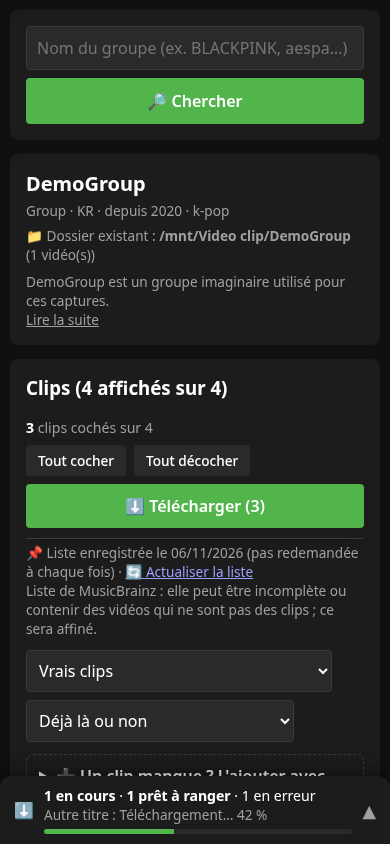
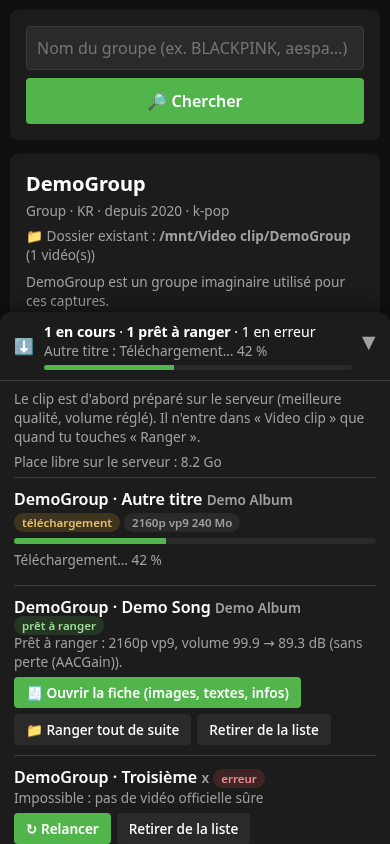
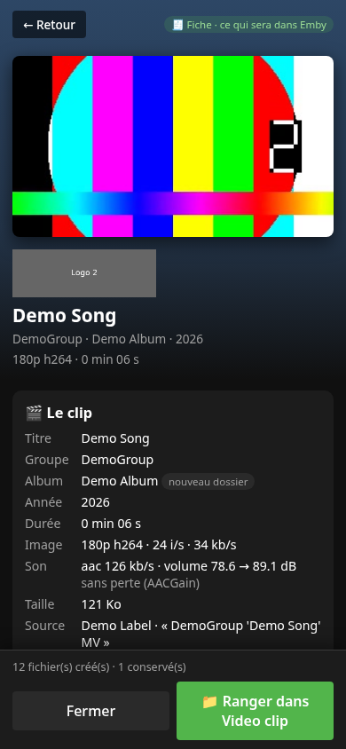
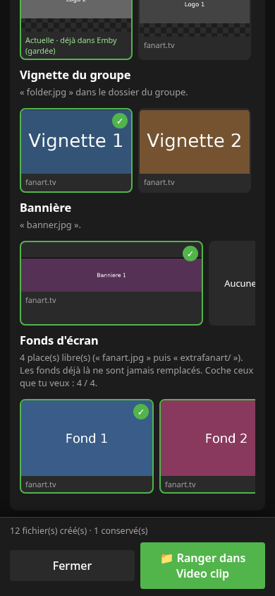

# MouFlip 🎤🎬

[](LICENSE)
[](https://www.python.org/downloads/)

**Les clips vidéo de tes groupes K-pop dans ta médiathèque Emby** : une appli web qui retrouve les clips officiels d'un groupe, les télécharge à la meilleure qualité, règle leur volume sans perte, puis les range avec leur fiche (`.nfo`, poster, images du groupe) dans le dossier « Video clip » d'Emby.

Tout se fait **à la demande** : aucune surveillance, aucun téléchargement tout seul, et **rien n'est écrit dans ta médiathèque sans ta confirmation**.

## 📸 Aperçu

*Captures avec des données de démonstration (aucun texte ni aucune image réels).*

**La liste des clips d'un groupe : ceux que tu as déjà, ceux à prendre, et la barre des téléchargements toujours visible en bas**



**La barre des téléchargements dépliée : avancement, fiche, rangement**



**La fiche d'un clip : tout ce qui sera visible dans Emby**



**Le choix des images quand plusieurs existent (logo, vignette, bannière, fonds d'écran, pochette, cdart)**



## ✨ Ce que fait MouFlip

1. **Ajouter un groupe** : tu tapes son nom. MouFlip retrouve sa fiche (MusicBrainz, TheAudioDB, Wikipédia) et la liste de ses clips officiels. La liste est **enregistrée** sur le serveur : elle n'est pas redemandée à chaque fois (« 🔄 Actualiser la liste » pour la mettre à jour).
2. **Choisir les clips** : coche ceux que tu veux. Ceux que tu as déjà dans « Video clip » sont repérés. « 👁️ Voir le clip » ouvre un lecteur pour vérifier la vidéo, et montre le format et la taille de chaque version, ou **toutes les qualités** d'une vidéo (1080p, 1440p, 4K) pour choisir.
3. **Télécharger** : yt-dlp (avec tes cookies YouTube, y compris le flux Premium) prend la meilleure qualité, ou celle que tu as choisie. L'image est recopiée **sans réencodage**.
3. **(Facultatif) Réduire la taille** : un clip 4K pèse 250 à 450 Mo. L'option « 📉 Réduire la taille » réencode l'image en VP9 (même format que tes clips actuels) pour environ **la moitié de la taille, avec une qualité égale à l'AV1 de YouTube** ; le son n'est pas touché. Environ 10 minutes par clip.
4. **Régler le volume** : même niveau que les thèmes de MouFlopening (ReplayGain, 89 dB), réglé **sans perte** avec [AACGain](https://github.com/dgilman/aacgain) quand le son est en AAC (paliers de 1,5 dB, aucun réencodage). Sinon le son est refait en AAC.
5. **La fiche** : avant de ranger, une fiche montre tout ce qui sera visible dans Emby : affiche, logo, bannière, fonds d'écran, pochette et cdart de l'album, biographie (modifiable), infos du clip, `.nfo`. Quand plusieurs images existent (fanart.tv, TheAudioDB, images prises dans la vidéo), **tu choisis**.
6. **Ranger** : sur confirmation, clip par clip. Les dossiers, le clip, son `.nfo` (`<musicvideo>`), son poster et les images du groupe sont créés, puis Emby relit le dossier.

### 🛡️ Les garde-fous
- **Rien n'est remplacé** : un fichier déjà présent est gardé. Seule exception : une image que tu choisis explicitement de remplacer ; l'ancienne est alors copiée dans `data/sauvegardes/` et la nouvelle doit être entièrement récupérée avant qu'on touche à l'ancienne.
- Le clip est **copié** (jamais déplacé) et sa taille est vérifiée.
- Un partage non monté ne plante rien : MouFlip le dit et n'écrit rien.
- **Seules les vidéos officielles** sont proposées : lives, concerts, émissions de télé, coulisses, chorégraphies, remix et re-publications de fans sont écartés.
- Les clés et les cookies ne sont jamais renvoyés à la page ni écrits dans le Journal.

### 🔗 Le lien avec Emby
Emby relie un clip à la page d'un artiste par son **nom** (le même artiste sert « Musique » et « Clips Vidéos »). La fiche vérifie l'écriture du nom dans Emby (« Aespa » ou « aespa ») et propose celle d'Emby, pour que le clip apparaisse sur la bonne page.

## 🚀 Installation

Sur un serveur Debian/Ubuntu (conteneur LXC Proxmox, par exemple), en root :

```bash
git clone https://github.com/mouflo/MouFlip.git /opt/mouflip
bash /opt/mouflip/install.sh
```

Le script installe ffmpeg, un environnement Python, deno (le moteur JavaScript dont yt-dlp a besoin), AACGain et le service `mouflip`. Ouvre ensuite `http://adresse-du-serveur:8004` puis ⚙️ **Réglages** :

- **Emby** : adresse et clé API (Tableau de bord → Clés API).
- **Dossier des clips** : ton dossier « Video clip ».
- **fanart.tv** : clé personnelle gratuite, pour les logos, bannières, fonds et pochettes (facultatif).
- **Cookies YouTube** : pour les formats réservés au compte Premium.

Détails : [INSTALL.md](INSTALL.md).

## 🧪 Tests

```bash
venv/bin/python -m unittest discover -s tests
```

Aucun réseau n'est utilisé : MusicBrainz, YouTube, fanart.tv et Emby sont remplacés, et les vidéos de test sont fabriquées par ffmpeg.

## 🗂️ Les sources de données
MusicBrainz (groupes, albums, clips), TheAudioDB (biographie, images), fanart.tv (logos, bannières, fonds, pochettes ; clé personnelle), Wikipédia (biographie de secours), YouTube (vidéos, via yt-dlp). IMVDb est prévu mais sa recherche est coupée chez eux pour l'instant.

## 📜 Licence
MIT : voir [LICENSE](LICENSE).
